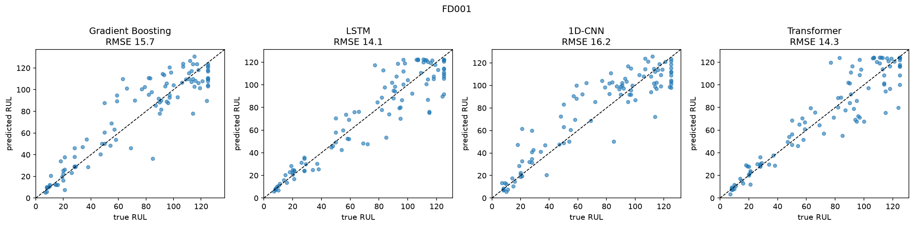
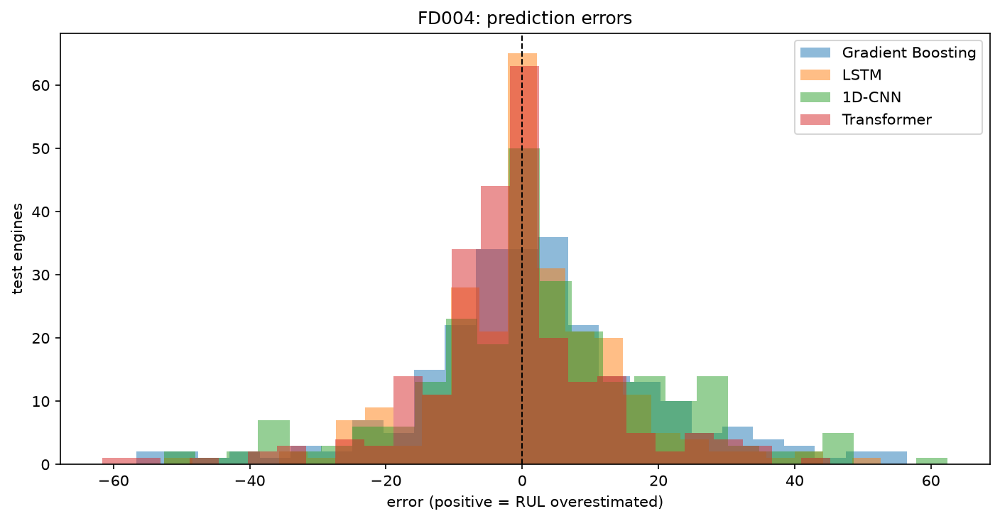

# Remaining Useful Life on NASA C-MAPSS

**Question:** on NASA's turbofan degradation data, does a sequence model that
reads the raw sensor history predict remaining useful life (RUL) better than
gradient boosting on hand-built rolling features - and by how much?

**Answer:** yes. Averaged over five seeds, the best sequence model beats
gradient boosting on all four C-MAPSS sub-datasets by 1.7 to 4.6 cycles of
test RMSE and cuts the PHM08 score by 32 to 56 percent. Every single seed of
the LSTM and of the Transformer beats gradient boosting, on every sub-dataset.
The two are level except on FD002, where the LSTM is better and steadier. The
1D-CNN built here does no better than gradient boosting.



## Data

C-MAPSS simulates turbofan engines running until
failure. Each sub-dataset has a training set of engines observed to failure,
and a test set of engines cut off at an unknown point along with their true
remaining life.

| Sub-dataset | Operating conditions | Fault modes | Train / test engines |
|---|---|---|---|
| FD001 | 1 | 1 | 100 / 100 |
| FD002 | 6 | 1 | 260 / 259 |
| FD003 | 1 | 2 | 100 / 100 |
| FD004 | 6 | 2 | 249 / 248 |

## Method

- **Target.** RUL = cycles left until failure, capped at 125. Engines look
  healthy for a long time before wear shows in the sensors, so an exact
  countdown from cycle 1 is not learnable. 125 is the usual cap in published
  work on this data.
- **Preprocessing.** On FD002/FD004 each row is assigned to one of six
  operating conditions (KMeans on the three setting columns), and every sensor
  is standardised within its condition. Otherwise the jump between conditions
  hides the much smaller wear signal. Sensors that are constant within a
  condition are dropped. Everything is fitted on training engines only.
- **Split.** 80 percent of training engines for fitting, 20 percent for
  validation, split by whole engine so no engine appears on both sides.
- **Models.** Gradient boosting (`HistGradientBoostingRegressor`) sees each
  cycle plus rolling mean and standard deviation of every sensor. The LSTM,
  1D-CNN and Transformer see the last `seq_len` cycles of raw sensor values.
- **Tuning.** 30 Optuna trials per model per dataset, minimising validation
  RMSE. Window length is tuned for every model.
- **Metrics.** RMSE and MAE in cycles, and the PHM08 score, which penalises
  overestimated RUL (the engine fails before its service) more than
  underestimated. All three are computed at the last observed cycle of each
  test engine. Lower is better.

## Results

### Test RMSE over five seeds

Each network is retrained with seeds 42-46 on the same split and the same
tuned parameters (`rul seeds`). Gradient boosting is deterministic, so it has
one number. Mean ± standard deviation, in cycles; lower is better.

| Model | FD001 | FD002 | FD003 | FD004 |
|---|---|---|---|---|
| LSTM | 14.29 ± 0.69 | **12.15 ± 0.24** | **13.18 ± 0.79** | 13.58 ± 0.33 |
| Transformer | **14.05 ± 0.65** | 13.80 ± 1.27 | 14.09 ± 0.42 | **13.36 ± 0.29** |
| 1D-CNN | 16.15 ± 0.47 | 16.96 ± 0.58 | 17.95 ± 2.08 | 19.05 ± 0.93 |
| Gradient Boosting | 15.72 | 16.50 | 16.81 | 17.96 |

Mean PHM08 of the best network vs gradient boosting: 341 vs 499 (FD001),
844 vs 1761 (FD002), 547 vs 826 (FD003), 915 vs 2085 (FD004). The per-seed
numbers are in `outputs/<dataset>/results/seeds.json`.

### One run per model (seed 42)

Val RMSE is what the tuning minimised, over every validation cycle, so it is
optimistic and not directly comparable with test RMSE, which is taken only at
each test engine's last cycle.

#### FD001 - one condition, one fault mode

| Model | Params | Val RMSE | Test RMSE | MAE | PHM08 |
|---|---|---|---|---|---|
| LSTM | 206465 | 10.69 | 14.15 | 10.55 | 303.0 |
| Transformer | 25953 | 10.48 | 14.33 | 10.15 | 355.7 |
| Gradient Boosting | - | 16.52 | 15.72 | 11.48 | 499.4 |
| 1D-CNN | 359169 | 16.05 | 16.23 | 12.25 | 503.4 |

#### FD002 - six conditions, one fault mode

| Model | Params | Val RMSE | Test RMSE | MAE | PHM08 |
|---|---|---|---|---|---|
| LSTM | 74369 | 12.12 | 12.40 | 8.12 | 1051.3 |
| Transformer | 200449 | 12.21 | 15.67 | 10.71 | 1697.2 |
| Gradient Boosting | - | 16.40 | 16.50 | 12.10 | 1760.5 |
| 1D-CNN | 359169 | 15.37 | 16.58 | 12.68 | 1643.4 |

#### FD003 - one condition, two fault modes

| Model | Params | Val RMSE | Test RMSE | MAE | PHM08 |
|---|---|---|---|---|---|
| LSTM | 74881 | 9.22 | 12.99 | 8.32 | 396.0 |
| Transformer | 151105 | 9.53 | 14.13 | 9.84 | 475.8 |
| Gradient Boosting | - | 13.88 | 16.81 | 11.84 | 825.7 |
| 1D-CNN | 5329 | 14.09 | 16.95 | 13.36 | 681.0 |

#### FD004 - six conditions, two fault modes

| Model | Params | Val RMSE | Test RMSE | MAE | PHM08 |
|---|---|---|---|---|---|
| LSTM | 21057 | 11.82 | 13.28 | 9.41 | 900.1 |
| Transformer | 25985 | 11.45 | 13.72 | 9.23 | 863.0 |
| Gradient Boosting | - | 18.25 | 17.96 | 12.87 | 2085.3 |
| 1D-CNN | 5329 | 16.68 | 18.41 | 13.43 | 2255.2 |

### What the numbers say

**Sequence models vs gradient boosting.** The gap is 1.7 cycles on FD001,
3.6 on FD003, 4.4 on FD002 and 4.6 on FD004 (best network's seed mean vs
gradient boosting). It is far larger than the seed-to-seed spread, so it is
not noise. It is smallest on the simplest sub-dataset and larger on the two
with six operating conditions.

**LSTM vs Transformer.** Their seed ranges overlap on FD001, FD003 and FD004,
so neither wins there. On FD002 the LSTM is better on average (12.15 vs 13.80)
and much steadier: the Transformer ranges from 12.31 to 15.67 depending on the
seed. A single run can mislead: with seed 42 alone the Transformer on FD002
is only 0.8 cycles ahead of gradient boosting (15.67 vs 16.50), against 2.7
on average over the five seeds.

**1D-CNN.** Worse than gradient boosting on average on all four, even where
the search gave it 359k parameters, so the problem is not size. It averages
its features over the whole window at the end and so loses where in the window
a pattern happened, which is probably where it falls behind.



## Limitations

- **One split.** The seed runs keep the train/validation split and the tuned
  parameters fixed, so they show run-to-run noise but not how much results
  move with a different split.
- **Tuned on a different target than it is scored on.** The search
  minimises RMSE over every validation cycle, many of which sit on the flat
  RUL = 125 stretch, while the test score uses only each engine's last cycle.
- **One training recipe for all networks.** AdamW with a constant learning
  rate and no warmup. That is standard for an LSTM, but Transformers are
  usually trained with warmup and a decaying learning rate, so this setup may
  undersell the Transformer. Its instability on FD002 points the same way.
- **Short windows.** Window length was searched up to 80 cycles, and the
  networks picked 40 to 80, most of them 60 or more, so longer windows might
  help.

## Setup

```bash
uv venv --python 3.12
source .venv/bin/activate
uv pip install -e ".[dev]"
pytest -q
```

Download C-MAPSS from the NASA Prognostics Data Repository and put the
`train_FD00x.txt`, `test_FD00x.txt` and `RUL_FD00x.txt` files in `CMAPSSData/`.

## Usage

```bash
rul explore --dataset FD001      # dataset summary, lifetime and sensor plots
rul tune    --dataset all        # Optuna search for every model
rul train   --dataset all        # train with the tuned parameters, score on test
rul compare --dataset all        # results tables and figures
rul explain --dataset FD001      # SHAP for gradient boosting, attention for the Transformer
rul run     --dataset all        # explore, tune, train, compare, explain in order
rul seeds   --dataset all        # retrain each network with 5 seeds to measure run-to-run noise

rul predict --model outputs/FD001/models/lstm.joblib --input CMAPSSData/test_FD001.txt
```

`--dataset` and `--model` take one or more names or `all`. Tuning progress is
stored in `outputs/optuna.db`, so an interrupted `rul tune` resumes.

## Layout

```
src/rul/
  datasets.py          C-MAPSS columns, loading and RUL labels
  preprocessing.py     engine-level split, condition-aware normalisation
  features.py          rolling features, sequence windows
  networks.py          LSTM, 1D-CNN, Transformer
  estimators.py        one fit/predict interface for all four models
  tuning.py            search spaces and the Optuna loop
  pipeline.py          train, evaluate, save
  config.py            sub-datasets, paths, seed, tuning budget
  metrics.py, plots.py, cli.py
tests/                 tests on small synthetic files, no download needed
outputs/<dataset>/     params/, results/, figures/ (models are not committed)
```
